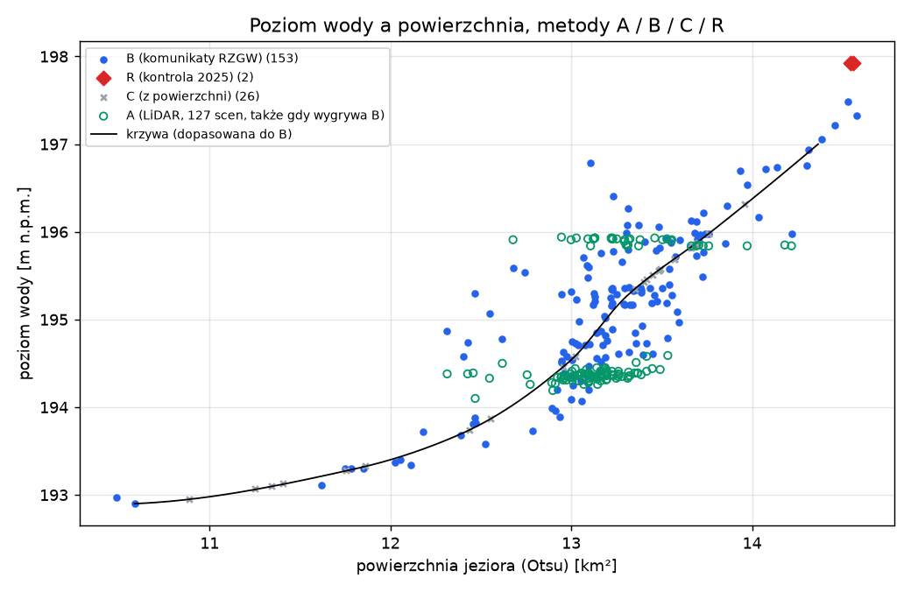
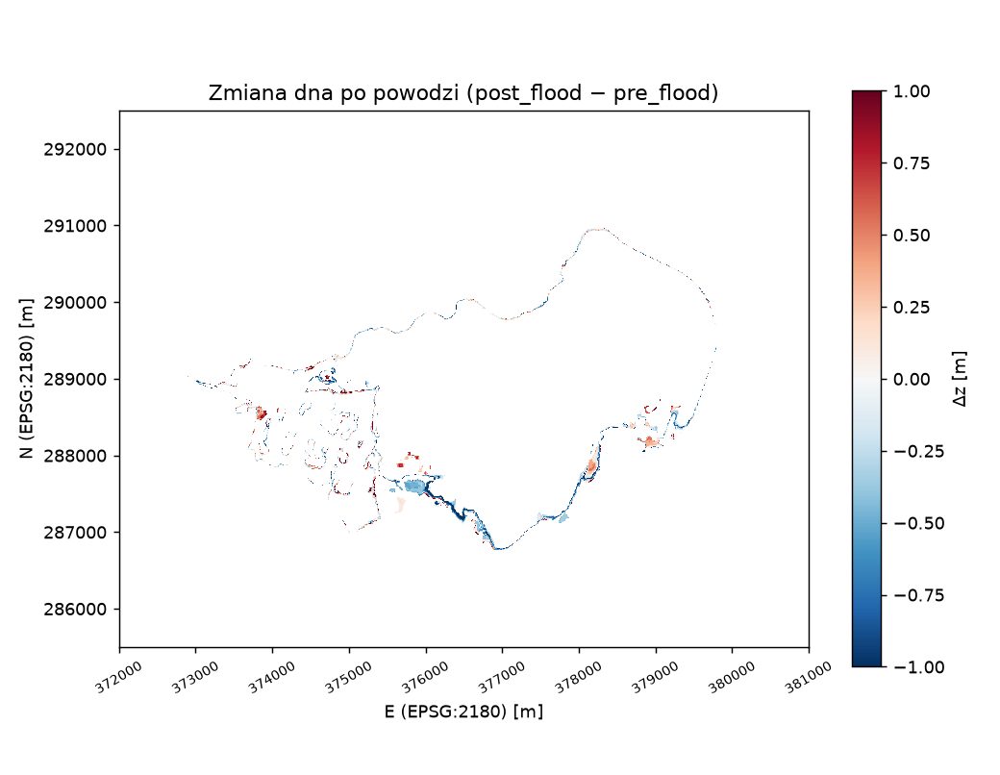
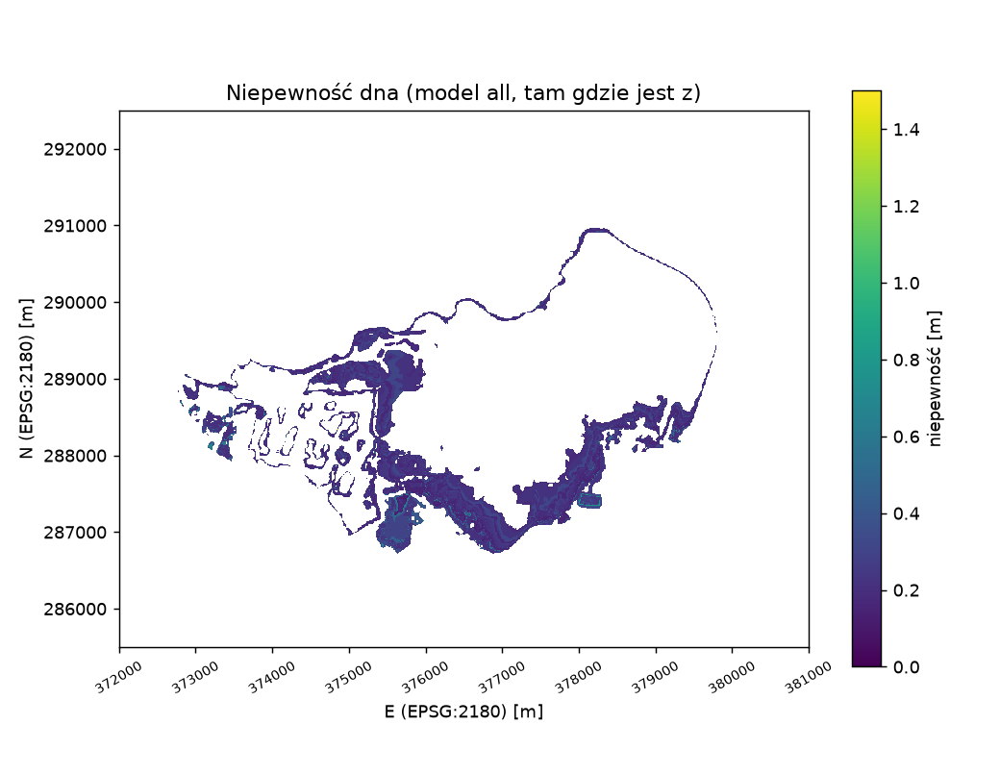
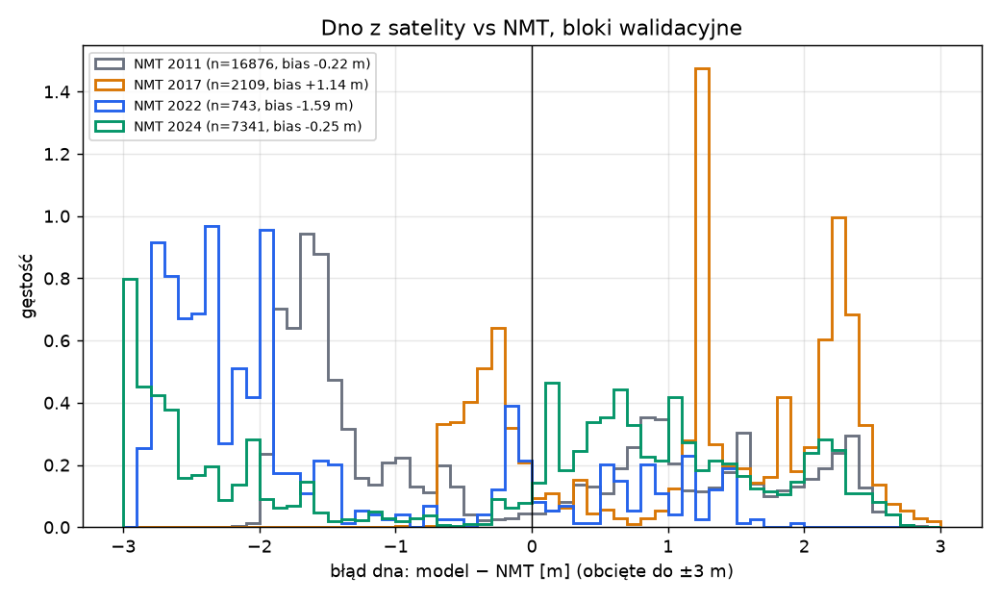
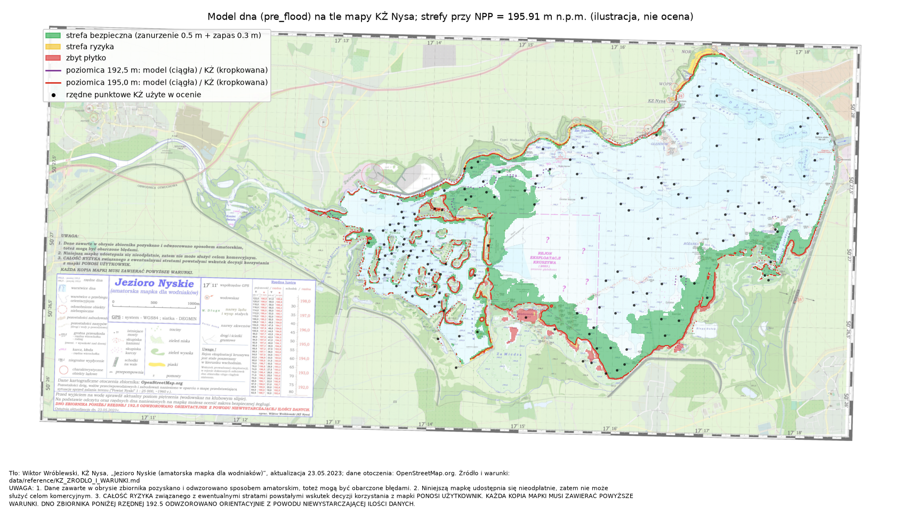
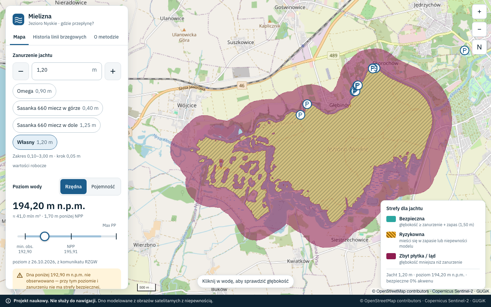
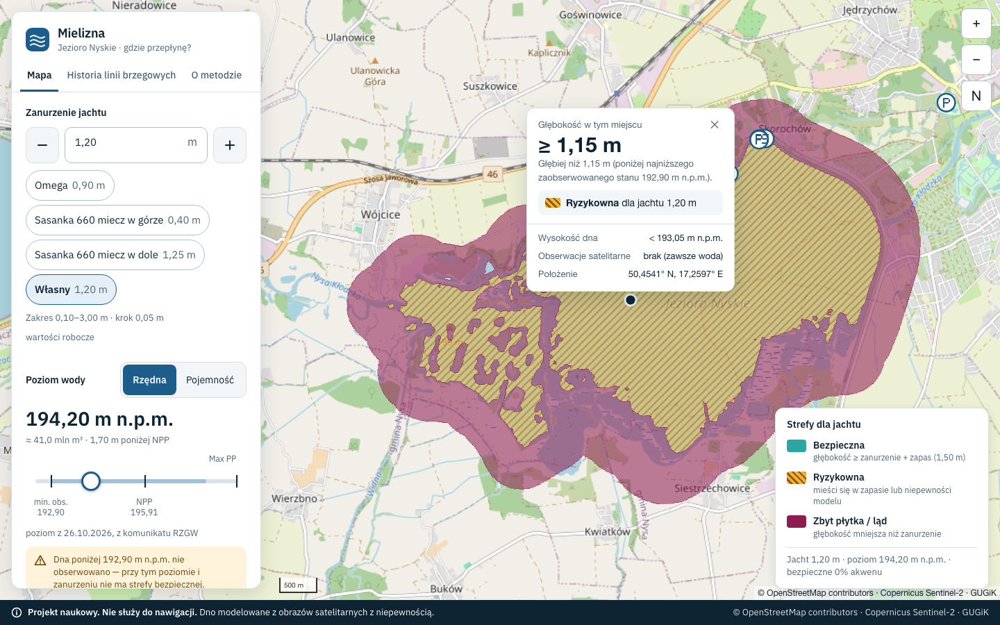
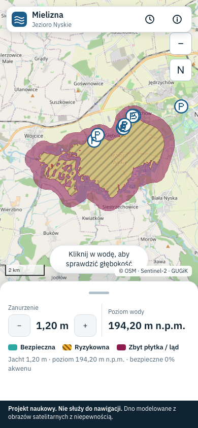

# Mielizna — raport: model dna Jeziora Nyskiego z Sentinel-2 i jego dokładność

Autor: Paweł Ostromecki. Stan: gałąź `feat/plan4`, październik 2026.

**Najważniejsze w pięciu zdaniach.** Model dna powstał wyłącznie z obrazów Sentinel-2 i znanego poziomu wody w dniu każdego
zdjęcia: piksel widziany jako woda przy poziomie `h` ma dno poniżej `h`, a widziany jako ląd ma dno powyżej. Na odsłoniętym
brzegu (NMT LiDAR, bloki walidacyjne) model z całego okresu jest średnio o +1,16<!-- eval:bottom_vs_nmt.json:all.bias --> m
**wyżej** niż teren (RMSE 1,51<!-- eval:bottom_vs_nmt.json:all.rmse --> m, n = 8 477<!-- eval:bottom_vs_nmt.json:all.n -->),
a jego przedziały [`z_min`, `z_max`] obejmują rzędną NMT tylko w 6,4 %<!-- eval:bottom_vs_nmt.json:all.share_in_bounds -->
pikseli; tej rozbieżności nie umiemy jeszcze w pełni wyjaśnić (otwarte ustalenie, §5.2). Pod wodą, w porównaniu z amatorską mapą
KŻ Nysa, model sprzed powodzi jest średnio o +0,31<!-- eval:kz_points.json:pooled.bias --> m płytszy (RMSE
0,84<!-- eval:kz_points.json:pooled.rmse --> m), ale na małej próbie (n = 32<!-- eval:kz_points.json:pooled.n -->) i tylko
w paśmie 192,5–195 m; to porównanie dotyczy wyłącznie modelu `pre_flood`, a model serwowany w aplikacji (`all`) ma jako
jedyną niezależną kontrolę wynik względem NMT podany wyżej. Model nie wie nic o dnie poniżej ok. 192,9 m (najniższy zaobserwowany poziom wody). **To projekt naukowy;
aplikacja nie służy do nawigacji** (ten sam napis jest w stopce aplikacji i na stronie „O metodzie”).

Konwencje. Rzędne w m n.p.m.; docelowy układ wysokości PL-EVRF2007-NH, ale poziomy z komunikatów RZGW mają układ nieznany
(§3.4). Bias = model − referencja (dodatni = dno modelu wyżej, czyli woda w modelu płytsza). Liczby z plików oceny
`data/processed/eval/*.json` mają w źródle tego pliku znacznik (komentarz HTML `eval:plik:klucz` tuż za liczbą), a test
`pipeline/tests/test_report_numbers.py` sprawdza, że zgadzają się z plikami (gramatyka znacznika w docstringu testu). Pozostałe
liczby mają podane źródło w tekście. Notatki do nauki z uzasadnieniami i pytaniami obronnymi: `docs/nauka/M1–M7`, decyzje:
`docs/nauka/decyzje.md`.

## Spis treści

1. [Dane i układy odniesienia](#1-dane-i-układy-odniesienia)
2. [Klasyfikacja woda/ląd](#2-klasyfikacja-wodaląd)
3. [Poziom wody `h_t`](#3-poziom-wody-h_t)
4. [Model dna](#4-model-dna)
5. [Ocena dokładności (BRIEF §7)](#5-ocena-dokładności-brief-7)
6. [Porównanie z mapą KŻ (K1–K5)](#6-porównanie-z-mapą-kż-k1k5)
7. [Aplikacja](#7-aplikacja)
8. [Ograniczenia: do czego model się nadaje, a do czego nie](#8-ograniczenia-do-czego-model-się-nadaje-a-do-czego-nie)
9. [Odtwarzalność](#9-odtwarzalność)

---

## 1. Dane i układy odniesienia

### 1.1 Źródła i licencje

| # | Dane | Źródło | Licencja / warunki | Użycie w projekcie |
|---|---|---|---|---|
| D1 | Sentinel-2 L2A, 2017–2026 (pasma B02, B03, B04, B08, B11, B12, SCL) | Copernicus (ESA/KE), katalog Earth Search (AWS) | dane Copernicus: bezpłatny, pełny i otwarty dostęp; atrybucja „zawiera zmodyfikowane dane Copernicus Sentinel 2017–2026” | maski woda/ląd, linie brzegowe, model dna, poziom na żywo w aplikacji |
| D2 | NMT 1 m i chmury punktów LiDAR (LAZ), epoki 2011, 2017, 2022, 2024 | GUGiK, Geoportal (PZGiK, skorowidze WFS) | dane PZGiK udostępniane bezpłatnie; źródło: GUGiK | poziom wody w dniu nalotu, wariant A `h_t`, ocena dna na odsłoniętym brzegu |
| D4 | Komunikaty o pojemności zbiornika Nysa | RZGW Wrocław (archiwum Wayback Machine, 11.2019–03.2024) i Wody Polskie (gov.pl; lista komunikatów sięga od 2024-02-26, więc obejmuje 03.2024–06.2025) | informacja publiczna; źródło: PGW Wody Polskie | wariant B `h_t` (pojemność → rzędna) |
| D5 | Obrys jeziora, zapora, przystanie, slipy | OpenStreetMap (Overpass) | ODbL 1.0, „© współtwórcy OpenStreetMap” | AOI, bufor zapory, warstwa przystani |
| D8 | „Jezioro Nyskie (amatorska mapka dla wodniaków)”, W. Wróblewski, KŻ Nysa, aktualizacja 23.05.2023 | `docs/JN_2023_05_23__KZ.pdf` | **bezpłatna, niekomercyjna; dane pozyskane sposobem amatorskim; ryzyko ponosi użytkownik; każda kopia musi zawierać warunki „UWAGA”** (pełny tekst: `data/reference/KZ_ZRODLO_I_WARUNKI.md`) | tabela pojemność ↔ rzędna (wariant B), walidacja dna (K5), kontrola `h_t` (wariant D), obrys żwirowni |
| — | Znane poziomy: piętrzenie 2025 (197,84–198,00 m), odpowiedź na interpelację (12.09.2024: 194,70 m) | komunikat RZGW 2025, interpelacja poselska | informacja publiczna | punkty kontrolne `h_t` (wariant R, kontrola M3) |

Projekt jest naukowy i niekomercyjny (bez przychodów, reklam i płatnych funkcji), więc mieści się w warunkach mapy KŻ. Każdy
plik pochodny z mapy KŻ odsyła do `data/reference/KZ_ZRODLO_I_WARUNKI.md`, a warstwa żwirowni w aplikacji ma atrybucję
„Obrys wg mapy KŻ Nysa (W. Wróblewski, 2023)”. Licencja MIT w `LICENSE` obejmuje tylko kod, nie dane (README, „Licencje”).

### 1.2 Układy odniesienia

| co | układ |
|---|---|
| obliczenia, rastry modelu | EPSG:2180 (PUWG 1992), siatka 10 m, E 372 000–381 000, N 285 500–292 500 (900 × 700 px) |
| sceny Sentinel-2 | EPSG:32633, przeliczane na siatkę 2180 |
| NMT/LiDAR 2011, 2017 | PL-KRON86-NH → EVRF2007 siatkami quasi-geoidy GUGiK (`mielizna/datum.py`): +0,199 m w środku jeziora, zmienność ok. 1 cm |
| NMT/LiDAR 2022, 2024 | PL-EVRF2007-NH |
| poziomy z komunikatów RZGW (B) i tabela KŻ | **nieznany** (`h_datum` w `scenes.json`); hipoteza: KRON86 (§3.4) |
| mapa KŻ | siatka WGS84 (stopnie i minuty) → EPSG:2180 wielomianem 2. stopnia (§6.1); układ rzędnych nieznany |
| aplikacja | EPSG:4326 / 3857 |

### 1.3 Sceny

- Akwizycje Sentinel-2 w katalogu: 679 wierszy (650 dat) w `scenes_candidates.csv`; po deduplikacji, filtrze chmur (lokalnie ≤ 5 %),
  braków danych i ręcznym przeglądzie lodu zostaje **221 scen** (2017-03-19 … 2026-10-26, `scenes.json`; po latach 7, 26, 21, 29,
  17, 21, 23, 21, 29, 27 dla 2017–2026). Do modelu dna wchodzi **218** (3 sceny odrzucone przez kontrolę jakości RF: 2019-06-15,
  2023-09-27, 2024-04-11).
- Odrzucona automatycznie: 2022-02-14 (produkt nieharmonizowany, SWIR nad wodą ok. 1000 DN; `scenes_pass2_rejected.csv`).
- Wykluczone ręcznie (`config.yaml: scene_filter.exclude_dates`, 15 dat; przegląd miniatur, zasada „w razie wątpliwości wyklucz”):

| data | powód (z `config.yaml`) |
|---|---|
| 2017-02-27 | lód na wschodzie i w środku jeziora, otwarta woda tylko na zachodzie |
| 2019-02-15 | lód we wschodniej części i wzdłuż brzegu S/E |
| 2019-02-17 | lód we wschodniej części, obrzeże lodu wzdłuż brzegu S/E |
| 2021-03-03 | dryfująca kra na wschodzie, połamany lód przy brzegu S i W |
| 2021-12-03 | niepewne: jasna tafla o ostrych krawędziach w zatoce SW, możliwy cienki lód |
| 2022-01-15 | jasne obrzeże lodu przy brzegu SE |
| 2023-02-09 | śryż / pasma kry na całym jeziorze |
| 2023-12-18 | białe plamy śniegu/lodu na linii wody przy brzegu SW i E |
| 2024-09-01 | **uszkodzony produkt L2A** (red/NIR/SWIR = 1 DN; strażnik radiometrii p99 = 0,0001) |
| 2025-01-19 | niepewne: białe plamy w bagiennych zatokach południa, możliwy lód/śnieg |
| 2025-12-12 | niepewne: jasna plama z krą przy południowym brzegu, możliwy cienki lód |
| 2026-02-28 | jezioro w większości skute (wschód i środek) |
| 2026-03-02 | jezioro w większości skute |
| 2026-03-05 | resztki lodu na wschodniej połowie i przy brzegu NE |
| 2026-03-07 | resztki kry w basenie NE przy zaporze |

Automatyczny wykrywacz lodu nie zadziałał (SCL klasa 11 = 0 % na jeziorze w każdej dacie, próg jasności łapie tylko grubą
pokrywę), stąd przegląd ręczny (M1, pytanie 6). Uwaga: 2017-02-27 to także pierwszy dzień nalotu LiDAR 2017 (§3.2).

---

## 2. Klasyfikacja woda/ląd

**Wskaźnik i próg.** Podstawą jest MNDWI = (zielony − SWIR1)/(zielony + SWIR1) (Xu 2006): w przeciwieństwie do NDWI nie myli wody
z zabudową i odsłoniętą glebą, a nad jeziorem po spuszczeniu wody jest głównie mokre błoto. Próg wody wyznacza metoda Otsu osobno
dla każdej sceny (`skimage.filters.threshold_otsu`, piksele AOI); progi MNDWI: mediana 0,167, zakres −0,228 … 0,259 (`scenes.json:
otsu_threshold`, 221 scen). Próg na scenę, a nie globalny, bo odbicie wody zmienia się z mętnością i porą roku.

**Random Forest.** 100 drzew, 16 cech (6 pasm, NDWI, MNDWI, AWEI ×2, NDVI, MNDWI − próg Otsu sceny, średnia i odchylenie MNDWI 3×3,
sin/cos dnia roku). Celowo bez wysokości NMT, częstości zalewania i `h_t` (przeciek do modelu dna). Etykiety: 294 punkty
automatyczne (tylko do uczenia) i **243 etykiety ręczne autora** (193 woda / 50 ląd) przy brzegu, na scenach S-2 z danego dnia.
Próg P(woda) t* = 0,70 z uśrednionej krzywej BA(t) (10 powtórzeń OOF; R18, R22 planu 1).

**Metryki** (walidacja grupowa: całe bloki 500 m albo całe sceny poza uczeniem):

| zbiór | metoda | OA | κ | F1 wody | BA | źródło |
|---|---|---|---|---|---|---|
| wszystkie wiersze (auto + ręczne), wg scen, n = 537<!-- eval:mask.json:by_scene.rf.n --> | RF @0,5 | 0,924<!-- eval:mask.json:by_scene.rf.oa --> | 0,837<!-- eval:mask.json:by_scene.rf.kappa --> | 0,939<!-- eval:mask.json:by_scene.rf.f1_water --> | 0,923<!-- eval:mask.json:by_scene.rf.bacc --> | `mask.json` |
| j.w. | RF @0,70 | 0,890<!-- eval:mask.json:by_scene.rf_t.oa --> | 0,772<!-- eval:mask.json:by_scene.rf_t.kappa --> | 0,909<!-- eval:mask.json:by_scene.rf_t.f1_water --> | 0,900<!-- eval:mask.json:by_scene.rf_t.bacc --> | `mask.json` |
| j.w. | Otsu | 0,853<!-- eval:mask.json:by_scene.otsu.oa --> | 0,706<!-- eval:mask.json:by_scene.otsu.kappa --> | 0,870<!-- eval:mask.json:by_scene.otsu.f1_water --> | 0,880<!-- eval:mask.json:by_scene.otsu.bacc --> | `mask.json` |
| j.w. | SCL = 6 | 0,864<!-- eval:mask.json:by_scene.scl.oa --> | 0,718<!-- eval:mask.json:by_scene.scl.kappa --> | 0,887<!-- eval:mask.json:by_scene.scl.f1_water --> | 0,872<!-- eval:mask.json:by_scene.scl.bacc --> | `mask.json` |
| **tylko ręczne punkty brzegowe, wg bloków, n = 185 (wynik główny M2)** | RF @0,5 | **0,897** [0,845–0,933] | 0,538 | — | **0,797** | `rf_report.md`, tab. A |
| j.w. | Otsu | 0,714 | 0,264 | — | 0,755 | j.w. |
| j.w. | „wszystko woda” | 0,886 | 0 | — | 0,500 | j.w. |

Wiersze `mask.json` zawierają łatwe punkty automatyczne i są **optymistyczne**; uczciwą miarą jest tabela A raportu RF (punkty ręczne
przy brzegu). **Kryterium M2 (OA ≥ 95 %) nie jest spełnione**: RF ma 89,7 % przy 88,6 % dla trywialnego „wszystko woda”; recall
lądu 14/21 (Otsu 17/21). Słabością RF jest jasne błoto przy niskiej wodzie uznawane za wodę, czyli kierunek groźny (dno wyglądałoby na
głębsze). Dlatego w modelu dna wodą jest tylko piksel, który obie maski (RF **i** Otsu) uznają za wodę, a lądem — gdy którakolwiek
pokazuje ląd (decyzja autora U1, R25; dowód, że to nigdy nie obniża `z_max`: M4 §2).

**Linia brzegowa.** Ocena z BRIEF §7 na ręcznie zdigitalizowanych liniach brzegowych **nie została wykonana**; zastąpiła ją ocena na
ręcznych punktach brzegowych (wyżej) i kontrola wizualna scen (decyzja w specyfikacji §2a). Pośrednią miarą położenia brzegu jest
porównanie poziomic z mapą KŻ (§6.4).

---

## 3. Poziom wody `h_t`

### 3.1 Warianty i pierwszeństwo

Każda scena dostaje `h_t`, `h_method`, `h_sigma` i `h_datum` (`scenes.json`). Pierwszeństwo: **R > B > A > C**; D jest wyłącznie
kontrolą.

| wariant | skąd `h_t` | σ | scen w modelu `all` |
|---|---|---|---|
| R | znany poziom (piętrzenie 2025: 197,92 m, `known_levels.csv`) | 0,08 m | 2<!-- eval:levels.json:n_scenes_by_method.R --> |
| B | komunikat RZGW/Wód Polskich: pojemność → rzędna z tabeli KŻ (66 wierszy) | 0,15<!-- eval:levels.json:h_sigma_by_method.B.median --> m (założenie: rozbieżność z interpelacją, zmiana krzywej pojemności, ±1 dzień) | 153<!-- eval:levels.json:n_scenes_by_method.B --> |
| A | NMT LiDAR wzdłuż linii brzegowej sceny (mediana wysokości brzegu) | mediana 0,22<!-- eval:levels.json:h_sigma_by_method.A.median --> m, maks. 0,30<!-- eval:levels.json:h_sigma_by_method.A.max --> m (rozrzut wzdłuż brzegu) | 37<!-- eval:levels.json:n_scenes_by_method.A --> |
| C | krzywa powierzchnia (Otsu) → rzędna, dopasowana na R i B | 0,49<!-- eval:levels.json:h_sigma_by_method.C.median --> m (RMSE „bez jednego roku”) | 26<!-- eval:levels.json:n_scenes_by_method.C --> |
| D | dopasowanie poziomicy powierzchni KŻ do brzegu sceny | — (kontrola, §6.5) | 0 |

Wariant A **uzupełnia luki B** (specyfikacja §5 pkt 7), a nie nadpisuje B: tam, gdzie są obie wartości, A okazał się obciążony
zależnie od epoki NMT (§3.3), więc `h_t` = B, a `h_t_a`, `h_t_b` i `h_diff_ab` zostają w `scenes.json` jako diagnostyka (P4-R8).
Z tego samego powodu krzywa C jest dopasowana bez A (LOO 0,466 m; z A było 0,508 m; P4-R11).

### 3.2 Epoki LiDAR i wariant A

Data nalotu pochodzi z czasu GPS punktów LAZ („adjusted standard GPS time”, bit 0 `global_encoding`), poziom wody z mediany punktów
klasy 9 (woda, ASPRS) na jeziorze (`data/processed/lidar/epochs.csv`):

| epoka | data nalotu | rozstęp dat [dni] | h wody (natywny) [m] | układ | h w EVRF2007 [m] |
|---|---|---|---|---|---|
| 2011 | 2011-03-20 (datę ma 1 z 4 arkuszy LAZ, pozostałe mają „GPS week time”) | 1 | 194,44 | KRON86 | 194,64 |
| 2017 | 2017-02-27 i 2017-03-25 | 26 | 193,39 | KRON86 | 193,59 |
| 2022 | 2022-03-23 | 0 | 195,69 | EVRF2007 | 195,69 |
| 2024 | 2024-09-06 | 0 | 194,89 | EVRF2007 | 194,89 |

Wariant A: linia brzegowa sceny co 5 m, tylko bloki 500 m „kalibracyjne” (szachownica, §5.2), bez bufora 150 m wokół zapory,
epoka z wodą co najmniej 0,2 m niższą niż szacunek sceny, mediana NMT punktów powyżej wody nalotu + 0,1 m; bramki: n ≥ 50,
≥ 3 z 8 sektorów, `h_sigma` < 0,3 m (kryterium M3). A dostało 129 scen, z czego **37 to luki B** (36 z epoki 2017). Pozostałe 92
mają B i służą do porównania A − B (§5.3).

Zastrzeżenia epok: (1) epoka 2017 ma dwa dni nalotu (rozstęp 26 dni), a 2017-02-27 jest wykluczony z serii S-2 za lód na jeziorze,
więc poziom 2017 mógł być mierzony częściowo na lodzie (wpływ prawdopodobnie centymetrowy, niezweryfikowany); (2) data 2011
pochodzi z jednego arkusza; (3) **epoki mieszają naloty**: arkusze NMT tej samej epoki niosą płaską wodę na różnych rzędnych
(2011: 194,43–194,69 m; 2024: 194,88–194,89 m na trzech arkuszach i 195,95–195,96 m na dwóch), czyli część arkuszy pochodzi z innego
dnia niż data z LAZ (`bottom_vs_nmt.json: by_epoch.*.sheet_water_native`).

### 3.3 A vs B

| epoka NMT użyta przez A | n | bias A − B [m] | RMSE [m] |
|---|---|---|---|
| 2017 | 54<!-- eval:levels.json:a_vs_b.by_lidar_epoch.2017.n --> | −0,35<!-- eval:levels.json:a_vs_b.by_lidar_epoch.2017.bias --> | 0,59<!-- eval:levels.json:a_vs_b.by_lidar_epoch.2017.rmse --> |
| 2022 | 12<!-- eval:levels.json:a_vs_b.by_lidar_epoch.2022.n --> | −0,33<!-- eval:levels.json:a_vs_b.by_lidar_epoch.2022.bias --> | 0,41<!-- eval:levels.json:a_vs_b.by_lidar_epoch.2022.rmse --> |
| 2024 | 26<!-- eval:levels.json:a_vs_b.by_lidar_epoch.2024.n --> | +0,59<!-- eval:levels.json:a_vs_b.by_lidar_epoch.2024.bias --> | 0,61<!-- eval:levels.json:a_vs_b.by_lidar_epoch.2024.rmse --> |
| **razem** | 92<!-- eval:levels.json:a_vs_b.n --> | −0,08<!-- eval:levels.json:a_vs_b.bias --> | 0,58<!-- eval:levels.json:a_vs_b.rmse --> (MAE 0,47<!-- eval:levels.json:a_vs_b.mae -->) |

Znak różnicy zależy od epoki, więc to obciążenie metody i pokrycia NMT (2017 i 2022: NMT tylko dla 2 arkuszy, wschodni nasyp;
mieszane naloty w 2024), a nie jedno stałe przesunięcie układu. Nie korygujemy go (P4-R12). Skutek: **37 poziomów A w lukach B
(głównie 2017) jest prawdopodobnie ok. 0,3 m za nisko** względem B. W dniu własnego nalotu (2024-09-06) A daje
194,41<!-- eval:levels.json:control_2024_09_12.scenes.1.A --> m, a woda w LiDAR-ze tego dnia stoi na 194,88–194,89 m: A jest
ok. 0,48 m za nisko.

### 3.4 Układy wysokości

- LiDAR 2011 i 2017 przeliczone z KRON86 do EVRF2007 (+0,199 m), 2022 i 2024 natywnie w EVRF2007. Wariant A jest w EVRF2007.
- Poziomy B (tabela KŻ) i R mają układ nieznany. Dwie obserwacje są zgodne z hipotezą „RZGW/KŻ = KRON86” (B w EVRF byłoby o ok.
  0,2 m wyżej): 2024-09-06 B = 194,61<!-- eval:levels.json:control_2024_09_12.scenes.1.B --> m wobec wody LiDAR 194,89 m
  (różnica 0,28 m), a interpelacja (12.09.2024: 194,70 m) + 0,199 m = 194,90 m. To jeden dzień i jedna wartość, więc **nic nie
  korygujemy**; różnica A − B i bias dna zawierają możliwe przesunięcie RZGW ↔ EVRF2007.
- Dowód przeciwny: gdyby B było w KRON86, B czytane jako EVRF byłoby o ok. 0,2 m za nisko, więc A − B powinno wynosić ok. +0,2 m.
  Tymczasem dla epok 2017 i 2022 A − B = −0,35<!-- eval:levels.json:a_vs_b.by_lidar_epoch.2017.bias --> m i
  −0,33<!-- eval:levels.json:a_vs_b.by_lidar_epoch.2022.bias --> m (tylko 2024: +0,59 m). Obciążenie metody A (§3.3) zasłania tu
  ewentualne przesunięcie układu, więc dane nie rozstrzygają hipotezy w żadną stronę.

### 3.5 Punkty kontrolne `h_t`

| punkt | B | A | C |
|---|---|---|---|
| piętrzenie 2025 (197,92 m; sceny 28.04 i 01.05.2025) | −0,13<!-- eval:levels.json:control_r_2025.by_method.B.bias --> m (n = 2) | brak (poza zasięgiem epok) | −0,61<!-- eval:levels.json:control_r_2025.by_method.C.bias --> m (krzywa refitowana bez R) |
| 12.09.2024, 194,70 m (scena 06.09) | −0,09<!-- eval:levels.json:control_2024_09_12.scenes.1.dB --> m | −0,29<!-- eval:levels.json:control_2024_09_12.scenes.1.dA --> m | +0,47<!-- eval:levels.json:control_2024_09_12.scenes.1.dC --> m |
| 12.09.2024, 194,70 m (scena 03.09) | −0,07<!-- eval:levels.json:control_2024_09_12.scenes.0.dB --> m | −0,30<!-- eval:levels.json:control_2024_09_12.scenes.0.dA --> m | +0,59<!-- eval:levels.json:control_2024_09_12.scenes.0.dC --> m |

Kryterium M3 (`h_sigma` A < 0,3 m; 06.09.2024 w 194,70 ± 0,3 m) jest spełnione dla wartości użytej w modelu (B). Na
12.09.2024 nie ma sceny, więc porównujemy z 03.09 i 06.09 (poziom przed falą powodziową był stały). Wykres
`docs/img/eval-poziom-powierzchnia.png` pokazuje sceny A/B/C/R na tle krzywej powierzchnia–rzędna.



---

## 4. Model dna

**Przedziały zalania.** Dla piksela 10 m: `z_max` = najniższy poziom, przy którym był wodą, `z_min` = najwyższy poziom, przy którym
był lądem; obie granice poszerzone o `h_sigma` sceny. Sprzeczne obserwacje (woda poniżej lądu) rozwiązuje próg minimalizujący liczbę
sprzeczności, a przy remisie bierzemy obwiednię (przedział szerszy, strona ostrożna). Woda ze scen C nie ustala `z_max` (R24 planu 1, poziom
C ma błąd 0,49 m skorelowany w roku); ląd ze scen C jest liczony. Szczegóły i dowody: M4.

**Model `all`** (218 scen, poziomy 192,90–197,92 m, `model/all/model_meta.json`): przedział w 42 130<!-- eval:../model/all/model_meta.json:counts.interval_px -->
pikselach AOI, „zawsze woda” 104 928<!-- eval:../model/all/model_meta.json:counts.always_water_px -->, „zawsze ląd”
103 363<!-- eval:../model/all/model_meta.json:counts.always_land_px -->; piksele ze sprzecznościami: 58 561<!-- eval:../model/all/model_meta.json:n_conflict_px -->
(23 % obserwowanych), skupione na brzegach, wyspach i w płytkiej zatoce zachodniej. Piksel „zawsze woda” ma tylko górną granicę
`z_max` ≈ 193,05 m, więc o dnie poniżej najniższego obserwowanego poziomu (192,90 m) model nie mówi nic.

**Okresy.** `pre_flood` (sceny do 31.08.2024, 155 scen, poziomy 192,90–196,79 m), `post_flood` (od 30.09.2024, 59 scen,
193,81–197,92 m) i `all`. Wrzesień 2024 (powódź) jest tylko w `all`.

**Zmiana dna po powodzi i wybór modelu.** Modele `pre_flood` i `post_flood` mają przedział w obu okresach tylko na
8 438<!-- eval:bottom_change.json:n --> pikselach, czyli 3,4 %<!-- eval:bottom_change.json:share_of_common_observed --> akwenu
obserwowanego w obu (250 292<!-- eval:bottom_change.json:n_common --> px). |Δz| większe niż suma niepewności ma
3 743<!-- eval:bottom_change.json:n_significant --> px = **1,5 %<!-- eval:bottom_change.json:share_significant --> akwenu wspólnego**,
poniżej progu 5 % (ograniczenie projektu), więc aplikacja serwuje model **`all`** (`eval/model_choice.json`). Mediana Δz = post − pre
wynosi −0,13<!-- eval:bottom_change.json:median_dz --> m. Zastrzeżenie: liczony względem pikseli z przedziałem w obu modelach udział
to aż 44,4 %<!-- eval:bottom_change.json:share_significant_overlap -->, ale to wąski pas brzegu, a część Δz wynika z różnych zakresów
poziomów obu okresów, nie z realnej zmiany dna; przy tym kryterium „|Δz| > suma niepewności” jest słabe, bo przedziały są przeufne
(§5.2). Wniosek: **nie wykazaliśmy istotnej zmiany dna, ale też jej nie wykluczyliśmy** (szczególnie poniżej 193,8 m, czego model
`post_flood` w ogóle nie widział).





---

## 5. Ocena dokładności (BRIEF §7)

### 5.1 Tabela §7

| co | referencja | wynik | ocena |
|---|---|---|---|
| Klasyfikacja woda/ląd | 243 ręczne etykiety brzegowe na scenach S-2 (nie ≥ 300 z ortofotomapy) + 294 automatyczne | ręczne, wg bloków: RF OA 0,897, BA 0,797, κ 0,538; wszystkie wiersze: RF OA 0,924<!-- eval:mask.json:by_scene.rf.oa -->, κ 0,837<!-- eval:mask.json:by_scene.rf.kappa -->, F1 wody 0,939<!-- eval:mask.json:by_scene.rf.f1_water -->; Otsu OA 0,853<!-- eval:mask.json:by_scene.otsu.oa -->, SCL 0,864<!-- eval:mask.json:by_scene.scl.oa --> | M2 (OA ≥ 95 %) **niespełnione** (§2) |
| Linia brzegowa | ręcznie zdigitalizowane linie | **nie wykonano** (zastąpione etykietami brzegowymi; pośrednio §6.4) | brak |
| Poziom `h_t` | 12.09.2024 (194,70 m), piętrzenie 2025 (197,92 m) | B: −0,09<!-- eval:levels.json:control_2024_09_12.scenes.1.dB --> m i −0,13<!-- eval:levels.json:control_r_2025.by_method.B.bias --> m; A: −0,29<!-- eval:levels.json:control_2024_09_12.scenes.1.dA --> m; C: +0,47<!-- eval:levels.json:control_2024_09_12.scenes.1.dC --> m i −0,61<!-- eval:levels.json:control_r_2025.by_method.C.bias --> m; A − B: MAE 0,47<!-- eval:levels.json:a_vs_b.mae -->, RMSE 0,58<!-- eval:levels.json:a_vs_b.rmse --> m (n = 92<!-- eval:levels.json:a_vs_b.n -->) | B dobrze na 2 punktach; A obciążone epokowo; C ±0,5–0,6 m |
| Model dna (`all`) | NMT LiDAR, piksele z bloków walidacyjnych | MAE 1,31<!-- eval:bottom_vs_nmt.json:all.mae -->, RMSE 1,51<!-- eval:bottom_vs_nmt.json:all.rmse -->, bias +1,16<!-- eval:bottom_vs_nmt.json:all.bias --> m; NMT ∈ [z_min, z_max]: 6,4 %<!-- eval:bottom_vs_nmt.json:all.share_in_bounds --> (n = 8 477<!-- eval:bottom_vs_nmt.json:all.n -->) | **słabo; otwarte ustalenie** (§5.2) |
| Model dna (`pre_flood`) | j.w., epoki 2011–2024 | MAE 0,82<!-- eval:bottom_vs_nmt.json:pre_flood.mae -->, RMSE 0,96<!-- eval:bottom_vs_nmt.json:pre_flood.rmse -->, bias +0,20<!-- eval:bottom_vs_nmt.json:pre_flood.bias --> m; w granicach 12,3 %<!-- eval:bottom_vs_nmt.json:pre_flood.share_in_bounds --> (n = 1 781<!-- eval:bottom_vs_nmt.json:pre_flood.n -->) | lepiej, ale przedziały wciąż przeufne |
| Metody dna (przedziały vs interpolacja poziomic) | — | **nie wykonano**: metoda porównawcza (TIN/IDW z linii brzegowych) nie została zaimplementowana | brak |
| Model vs mapa KŻ (punkty ≥ 192,5 m, bez żwirowni) | 47<!-- eval:kz_points.json:pooled.n_spots --> punktów KŻ, z modelem w pikselu 32<!-- eval:kz_points.json:pooled.n --> | bias +0,31<!-- eval:kz_points.json:pooled.bias -->, MAE 0,60<!-- eval:kz_points.json:pooled.mae -->, RMSE 0,84<!-- eval:kz_points.json:pooled.rmse --> m; KŻ ∈ [z_min, z_max]: 31 %<!-- eval:kz_points.json:pooled.share_in_bounds --> | go (\|bias\| < 0,5 m); orientacyjne |
| Poziomice modelu vs KŻ | 195,0 m (KŻ 7,01<!-- eval:kz_contours.json:[195.0].kz_length_km --> km), 192,5 m (KŻ 2,40<!-- eval:kz_contours.json:[192.5].kz_length_km --> km) | 195,0: średnia symetryczna 47<!-- eval:kz_contours.json:[195.0].mean_distance_m --> m, KŻ → model 36,6<!-- eval:kz_contours.json:[195.0].kz_to_model_mean_m --> m (P90 77,8<!-- eval:kz_contours.json:[195.0].kz_to_model_p90_m --> m), Hausdorff 258<!-- eval:kz_contours.json:[195.0].hausdorff_m --> m; 192,5: model nie ma takiej poziomicy | orientacyjne |
| `h_t` wariant D vs A/B | 107<!-- eval:variant_d.json:n_valid --> scen w dziedzinie D (`h_t` < 194,95<!-- eval:variant_d.json:h_max_valid --> m) | w ±0,2 m: 27,1 %<!-- eval:variant_d.json:share_within_0_2 --> scen (A 55,6 %<!-- eval:variant_d.json:by_method.A.share_within_0_2 -->, B 14,8 %<!-- eval:variant_d.json:by_method.B.share_within_0_2 -->, C 0 %<!-- eval:variant_d.json:by_method.C.share_within_0_2 -->); mediana \|D − h_t\| 0,28<!-- eval:variant_d.json:median_abs_diff --> m | kryterium „większość w ±0,2 m” **niespełnione**; D tylko zgrubną kontrolą |



### 5.2 Dno vs NMT LiDAR (szczegóły)

**Unikanie przecieku.** Siatka modelu jest podzielona na bloki 500 m w szachownicę (`(i + j) % 2`, `mielizna/blocks.py`): wariant A
próbkuje NMT wyłącznie w blokach „kalibracyjnych”, a ocena dna liczy się wyłącznie w blokach „walidacyjnych”. NMT, z którego wzięto
poziom wody, nie ocenia więc dna, które z tego poziomu powstało. Szachownica, a nie np. podział północ/południe, bo oba zbiory
pokrywają cały obwód jeziora równomiernie.

**Co porównujemy.** `z` (środek przedziału) vs NMT uśredniony z 1 m do 10 m (≥ 50 % pokrycia piksela). Woda w NMT jest
spłaszczona na rzędnej różnej dla arkusza, więc odrzucamy: komórki ≤ powierzchnia wody arkusza + 0,1 m (dominanta histogramu
arkusza), piksele 10 m o odchyleniu komórek < 0,03 m (płaskie), żwirownię oraz piksele ≤ woda epoki + 0,1 m. Bez tej poprawki
37–86 % ocenianych pikseli było wodą liczoną jako ląd (P4-R24). Stałe 2 %, 0,03 m i 0,1 m nie są walidowane.

| epoka NMT | model | n | MAE [m] | RMSE [m] | bias [m] | NMT w [z_min, z_max] | korelacja |
|---|---|---|---|---|---|---|---|
| 2011 | `all` | 4 154<!-- eval:bottom_vs_nmt.json:by_epoch.2011.all.n --> | 1,35<!-- eval:bottom_vs_nmt.json:by_epoch.2011.all.mae --> | 1,53<!-- eval:bottom_vs_nmt.json:by_epoch.2011.all.rmse --> | +1,16<!-- eval:bottom_vs_nmt.json:by_epoch.2011.all.bias --> | 5,8 %<!-- eval:bottom_vs_nmt.json:by_epoch.2011.all.share_in_bounds --> | 0,31<!-- eval:bottom_vs_nmt.json:by_epoch.2011.all.corr --> |
| 2017 | `all` | 1 466<!-- eval:bottom_vs_nmt.json:by_epoch.2017.all.n --> | 1,40<!-- eval:bottom_vs_nmt.json:by_epoch.2017.all.mae --> | 1,64<!-- eval:bottom_vs_nmt.json:by_epoch.2017.all.rmse --> | +1,19<!-- eval:bottom_vs_nmt.json:by_epoch.2017.all.bias --> | 7,1 %<!-- eval:bottom_vs_nmt.json:by_epoch.2017.all.share_in_bounds --> | 0,86<!-- eval:bottom_vs_nmt.json:by_epoch.2017.all.corr --> |
| 2022 | `all` | 65<!-- eval:bottom_vs_nmt.json:by_epoch.2022.all.n --> | 0,92<!-- eval:bottom_vs_nmt.json:by_epoch.2022.all.mae --> | 1,15<!-- eval:bottom_vs_nmt.json:by_epoch.2022.all.rmse --> | −0,21<!-- eval:bottom_vs_nmt.json:by_epoch.2022.all.bias --> | 4,6 %<!-- eval:bottom_vs_nmt.json:by_epoch.2022.all.share_in_bounds --> | −0,18<!-- eval:bottom_vs_nmt.json:by_epoch.2022.all.corr --> |
| 2024 | `all` | 2 792<!-- eval:bottom_vs_nmt.json:by_epoch.2024.all.n --> | 1,20<!-- eval:bottom_vs_nmt.json:by_epoch.2024.all.mae --> | 1,41<!-- eval:bottom_vs_nmt.json:by_epoch.2024.all.rmse --> | +1,16<!-- eval:bottom_vs_nmt.json:by_epoch.2024.all.bias --> | 7,1 %<!-- eval:bottom_vs_nmt.json:by_epoch.2024.all.share_in_bounds --> | 0,21<!-- eval:bottom_vs_nmt.json:by_epoch.2024.all.corr --> |
| razem | `all` | 8 477<!-- eval:bottom_vs_nmt.json:all.n --> | 1,31<!-- eval:bottom_vs_nmt.json:all.mae --> | 1,51<!-- eval:bottom_vs_nmt.json:all.rmse --> | +1,16<!-- eval:bottom_vs_nmt.json:all.bias --> | 6,4 %<!-- eval:bottom_vs_nmt.json:all.share_in_bounds --> | — |
| 2011 | `pre_flood` | 834<!-- eval:bottom_vs_nmt.json:by_epoch.2011.pre_flood.n --> | 0,98<!-- eval:bottom_vs_nmt.json:by_epoch.2011.pre_flood.mae --> | 1,08<!-- eval:bottom_vs_nmt.json:by_epoch.2011.pre_flood.rmse --> | +0,14<!-- eval:bottom_vs_nmt.json:by_epoch.2011.pre_flood.bias --> | 3,0 %<!-- eval:bottom_vs_nmt.json:by_epoch.2011.pre_flood.share_in_bounds --> | −0,22<!-- eval:bottom_vs_nmt.json:by_epoch.2011.pre_flood.corr --> |
| 2017 | `pre_flood` | 700<!-- eval:bottom_vs_nmt.json:by_epoch.2017.pre_flood.n --> | 0,64<!-- eval:bottom_vs_nmt.json:by_epoch.2017.pre_flood.mae --> | 0,82<!-- eval:bottom_vs_nmt.json:by_epoch.2017.pre_flood.rmse --> | +0,30<!-- eval:bottom_vs_nmt.json:by_epoch.2017.pre_flood.bias --> | 25,0 %<!-- eval:bottom_vs_nmt.json:by_epoch.2017.pre_flood.share_in_bounds --> | 0,76<!-- eval:bottom_vs_nmt.json:by_epoch.2017.pre_flood.corr --> |
| 2022 | `pre_flood` | 43<!-- eval:bottom_vs_nmt.json:by_epoch.2022.pre_flood.n --> | 0,70<!-- eval:bottom_vs_nmt.json:by_epoch.2022.pre_flood.mae --> | 1,05<!-- eval:bottom_vs_nmt.json:by_epoch.2022.pre_flood.rmse --> | −0,67<!-- eval:bottom_vs_nmt.json:by_epoch.2022.pre_flood.bias --> | 16,3 %<!-- eval:bottom_vs_nmt.json:by_epoch.2022.pre_flood.share_in_bounds --> | −0,50<!-- eval:bottom_vs_nmt.json:by_epoch.2022.pre_flood.corr --> |
| 2024 | `pre_flood` | 204<!-- eval:bottom_vs_nmt.json:by_epoch.2024.pre_flood.n --> | 0,76<!-- eval:bottom_vs_nmt.json:by_epoch.2024.pre_flood.mae --> | 0,86<!-- eval:bottom_vs_nmt.json:by_epoch.2024.pre_flood.rmse --> | +0,31<!-- eval:bottom_vs_nmt.json:by_epoch.2024.pre_flood.bias --> | 5,9 %<!-- eval:bottom_vs_nmt.json:by_epoch.2024.pre_flood.share_in_bounds --> | 0,27<!-- eval:bottom_vs_nmt.json:by_epoch.2024.pre_flood.corr --> |
| razem | `pre_flood` | 1 781<!-- eval:bottom_vs_nmt.json:pre_flood.n --> | 0,82<!-- eval:bottom_vs_nmt.json:pre_flood.mae --> | 0,96<!-- eval:bottom_vs_nmt.json:pre_flood.rmse --> | +0,20<!-- eval:bottom_vs_nmt.json:pre_flood.bias --> | 12,3 %<!-- eval:bottom_vs_nmt.json:pre_flood.share_in_bounds --> | — |
| 2024 | `post_flood` (informacyjnie) | 2 741<!-- eval:bottom_vs_nmt.json:by_epoch.2024.post_flood_informational.n --> | 1,31<!-- eval:bottom_vs_nmt.json:by_epoch.2024.post_flood_informational.mae --> | 1,46<!-- eval:bottom_vs_nmt.json:by_epoch.2024.post_flood_informational.rmse --> | +1,29<!-- eval:bottom_vs_nmt.json:by_epoch.2024.post_flood_informational.bias --> | 8,6 %<!-- eval:bottom_vs_nmt.json:by_epoch.2024.post_flood_informational.share_in_bounds --> | 0,45<!-- eval:bottom_vs_nmt.json:by_epoch.2024.post_flood_informational.corr --> |

NMT 2024 pochodzi z 06.09.2024, sprzed powodzi z połowy września, więc model `pre_flood` jest właściwy dla wszystkich epok, a
`post_flood` vs 2024 to tylko informacja (dno po powodzi vs teren przed nią). Część różnic w epoce 2011 to realne zmiany przed
serią Sentinel-2.

**Otwarte ustalenie: model `all` leży ok. 1,2 m wyżej niż teren.** Bias +1,16 m powtarza się w 2011, 2017 i 2024 (w 2022 jest
−0,21 m przy n = 65, więc nie jest to „stała”), a rozkład błędów na histogramie jest dwumodalny (szczyty ok. +0,6 m i ok. +2,2 m).
Przedziały są przeufne: NMT mieści się w nich w 5–7 % pikseli zamiast w większości. Hipotezy, niesprawdzone:

1. maska lądu w zarośniętych i zalewanych marginesach brzegu (piksele 10 m mieszane woda/ląd/roślinność; RF ∧ Otsu celowo
   wybiera ląd przy wątpliwości, a to podnosi `z_min` i `z`);
2. „osiągalność” zamiast wysokości: woda dochodzi do piksela dopiero przy poziomie wyższym niż jego wysokość NMT (nasypy, wały,
   zagłębienia odcięte od jeziora), więc `z_max` mierzy próg zalania, a nie teren;
3. układ wysokości RZGW ↔ EVRF2007: jeśli poziomy B są w KRON86 (§3.4), model byłby raczej o ok. 0,2 m za **nisko**, czyli to
   przesunięcie ma przeciwny znak i nie wyjaśnia +1,16 m; jego udziału nie znamy.

`pre_flood` jest wyraźnie lepszy (bias +0,20 m, RMSE 0,96 m), bo ma mniej scen o wysokim poziomie i nie zawiera powodzi;
dlaczego model `all` jest gorszy aż o tyle, nie zostało zbadane. Bias jest dodatni, czyli na odsłoniętym brzegu model
**zaniża** głębokość (kierunek ostrożny), ale przy RMSE większym niż bias pojedyncze piksele mogą być po stronie niebezpiecznej.

### 5.3 Poziomy wody (szczegóły)

`h_sigma` wg metody (mediana): A 0,22 m, B 0,15 m, C 0,49 m, R 0,08<!-- eval:levels.json:h_sigma_by_method.R.median --> m.
A vs B i punkty kontrolne: §3.3 i §3.5. Krzywa C: LOO RMSE 0,466 m, LOYO 0,488 m (n = 131 obserwacji B/R,
`model/area_level_curve.json`).

---

## 6. Porównanie z mapą KŻ (K1–K5)

Mapa KŻ jest amatorska („dane pozyskano i odwzorowano sposobem amatorskim”), a dno poniżej 192,5 m autor mapy opisuje jako
orientacyjne. Dlatego służy tylko do walidacji i kontroli, nigdy jako dane wejściowe modelu, a wszystkie wyniki z tej sekcji są
**orientacyjne**. Warunki „UWAGA” są na nakładce i w `data/reference/KZ_ZRODLO_I_WARUNKI.md`.

### 6.1 K1 — georeferencja

Skan 9867 × 4791 px, siatka WGS84 co 0,5′ rysowana cyfrowo; 19<!-- eval:../kz/kz_meta.json:n_fit --> punktów dopasowania i
10<!-- eval:../kz/kz_meta.json:n_check --> wstrzymanych (przecięcia siatki). Wielomian 2. stopnia: RMSE na punktach wstrzymanych
0,13<!-- eval:../kz/kz_meta.json:rmse_check --> m (afiniczna 0,77<!-- eval:../kz/kz_meta.json:rmse_by_kind.affine.rmse_check --> m),
werdykt `good`. **To RMSE jest wewnętrzne dla siatki** (`rmse_scope: graticule-internal`: punkty kontrolne leżą na tych samych
liniach), więc mówi o spójności skanu, nie o dokładności treści mapy. Kontrola zewnętrzna — krawędź zapory od strony wody (OSM)
vs pas zapory na mapie, 281 normalnych: mediana −2,0<!-- eval:../kz/kz_meta.json:dam_offset_m --> m, rozrzut
11,9<!-- eval:../kz/kz_meta.json:dam_offset_spread_m --> m (1,4826·MAD), więc wynik jest **jakościowy**: położenie treści mapy
znamy z dokładnością rzędu kilkunastu metrów, nie 0,13 m.

### 6.2 K2 — rzędne punktowe (OCR)

OCR `tesseract` (dwa przebiegi) → 331 słów o kształcie rzędnej 185–200 m → 149 punktów z jednoznaczną kropką pomiaru w obrysie
jeziora. **Wszystkie 149<!-- eval:kz_compare.json:ocr_error_rate.n_judged --> autor ocenił ręcznie**:
138<!-- eval:kz_compare.json:ocr_error_rate.qc_counts.ok --> poprawnych, 9<!-- eval:kz_compare.json:ocr_error_rate.qc_counts.corrected -->
poprawionych, 2<!-- eval:kz_compare.json:ocr_error_rate.qc_counts.rejected --> odrzucone (`data/reference/kz_spot_qc.csv`). Błąd OCR
7,4 %<!-- eval:kz_compare.json:ocr_error_rate.rate_weighted -->, czyli w progu ≤ 10 %, ale próba (149) jest mniejsza niż 200 wymaganych
w briefie, bo tyle punktów w ogóle przeszło detekcję (P4-R16). Kontrola ręczna ocenia rzędną, nie położenie kropki, a lokalizator kropki
bywa mylony; 2 punkty z ewidentnie złą kotwicą wykluczono jawną listą w `config.yaml: kz.spot_position_reject` (P4-R30). Do porównań
weszło 145<!-- eval:kz_points.json:n_spots_used --> punktów; 3<!-- eval:kz_points.json:gravel_excluded --> leżą w żwirowni.

### 6.3 K3 — poziomice i żwirownia

Wszystkie poziomice na mapie mają jeden kolor, więc rzędną rozpoznajemy po wypełnieniu obok (biały pas 192,5–195,0 m, błękit
głębiej, ląd powyżej 195,0). Zasada „precyzja przed kompletnością”: zostaje 19<!-- eval:kz_contours.json:[192.5].n_kz_lines -->
linii 192,5 m (2,40 km) i 49<!-- eval:kz_contours.json:[195.0].n_kz_lines --> linii 195,0 m (7,01 km) — głównie brzegi wysp i
półwyspów; większa część brzegu 195,0 m jest pominięta. Obrys „REJON EKSPLOATACJI KRUSZYWA (2023)” (5 wierzchołków wskazanych
ręcznie, 176 ha) trafia do maski wykluczeń i do warstwy ostrzeżeń w aplikacji. K4 (tabela pojemność ↔ rzędna) powstała w planie 1.

### 6.4 K5 — porównania (model `pre_flood`, bias = model − KŻ)

| pasmo rzędnych KŻ | punktów KŻ | n z modelem | bias [m] | MAE [m] | RMSE [m] | KŻ w [z_min, z_max] |
|---|---|---|---|---|---|---|
| [192,5; 195,0) | 41<!-- eval:kz_points.json:[192.5-195.0].n_spots --> | 31<!-- eval:kz_points.json:[192.5-195.0].n --> | +0,30<!-- eval:kz_points.json:[192.5-195.0].bias --> | 0,60<!-- eval:kz_points.json:[192.5-195.0].mae --> | 0,85<!-- eval:kz_points.json:[192.5-195.0].rmse --> | 32 %<!-- eval:kz_points.json:[192.5-195.0].share_in_bounds --> |
| [195,0; NPP = 195,91<!-- eval:kz_points.json:npp -->) | 3<!-- eval:kz_points.json:[195.0-npp].n_spots --> | 1<!-- eval:kz_points.json:[195.0-npp].n --> | +0,64<!-- eval:kz_points.json:[195.0-npp].bias --> | — | — | — |
| ≥ NPP | 3<!-- eval:kz_points.json:[npp+].n_spots --> | 0<!-- eval:kz_points.json:[npp+].n --> | — | — | — | — |
| < 192,5 (orientacyjne, poza metrykami) | 95<!-- eval:kz_points.json:[below_192.5].n_spots --> | 0<!-- eval:kz_points.json:[below_192.5].n --> | — | — | — | — |
| **≥ 192,5 łącznie** | 47<!-- eval:kz_points.json:pooled.n_spots --> | **32<!-- eval:kz_points.json:pooled.n -->** | **+0,31<!-- eval:kz_points.json:pooled.bias -->** | 0,60<!-- eval:kz_points.json:pooled.mae --> | **0,84<!-- eval:kz_points.json:pooled.rmse -->** | 31 %<!-- eval:kz_points.json:pooled.share_in_bounds --> |

Zgodnie z planem przy werdykcie `good` porównujemy piksel 10 m modelu pod punktem (`unit: pixel10`); agregacja w komórkach 50 m
(BRIEF §6.6) była przewidziana tylko dla georeferencji „tylko porównania zagregowane”. Wobec niepewności położenia rzędu kilkunastu
metrów (§6.1) to wybór raczej optymistyczny. Pasmo < 192,5 m ma n = 0, bo model nie ma `z` poniżej 192,94 m — to fakt o modelu, nie wynik.

**Poziomice.** 195,0 m: poziomica modelu ma 19,28<!-- eval:kz_contours.json:[195.0].model_length_km_total --> km, z czego
8,84<!-- eval:kz_contours.json:[195.0].model_length_km_compared --> km leży w buforze 150 m wokół linii KŻ; odległość KŻ → model
średnio 36,6 m (P90 77,8 m), średnia symetryczna 47 m, Hausdorff 258 m. Bliższa prawdzie jest odległość KŻ → model, bo nadmiar
poziomicy modelu w buforze podnosi średnią symetryczną. 192,5 m: model takiej poziomicy nie ma (długość
0<!-- eval:kz_contours.json:[192.5].model_length_km_total --> km), więc porównania nie ma.

**Go / no-go: `go`** (|bias| = 0,31 m < 0,5<!-- eval:kz_compare.json:go_no_go.limit --> m). Sprawdzone przyczyny (`go_no_go.notes`):
(1) układ wysokości KŻ nieznany; bias jest bliski przesunięciu KRON86 → EVRF2007 (+0,199 m) i biasowi `pre_flood` względem LiDAR
(+0,20 m), ale zgodność może być przypadkowa; (2) mapa z 23.05.2023 opisuje dno sprzed powodzi, tak jak model `pre_flood`; (3) sposób
pomiaru amatorski, bez podanej niepewności.

**Co znaczy bias +0,31 m.** Dno modelu jest średnio o 0,31 m wyżej niż rzędna KŻ, czyli model pokazuje wodę średnio o tyle
**płytszą** niż mapa (kierunek ostrożny dla żeglarza). Ale RMSE 0,84 m jest prawie trzy razy większe niż bias, a tylko 31 % punktów KŻ
mieści się w przedziale modelu: pojedyncze miejsca mogą być w modelu głębsze niż na mapie. Próba jest mała (32 punkty) i dotyczy
tylko pasa 192,5–195 m. **Zakres wniosku:** porównanie z KŻ dotyczy wyłącznie modelu `pre_flood` (mapa z 2023 r.); model `all`,
serwowany w aplikacji, nie był porównywany z KŻ, a jego jedyną niezależną kontrolą jest +1,16 m względem NMT (§5.2).

### 6.5 Wariant D — kontrola `h_t`

Z punktów KŻ i poziomic budujemy powierzchnię (TIN, siatka 10 m; pokrycie
81,9 %<!-- eval:variant_d.json:surface_coverage_lake --> jeziora) i dla każdej sceny szukamy rzędnej, której poziomica najlepiej
pasuje do linii brzegowej. Powierzchnia opisuje tylko niskie poziomy, więc dziedzina D to `h_t` <
194,95<!-- eval:variant_d.json:h_max_valid --> m: 107 z 218<!-- eval:variant_d.json:n_fitted --> scen
(111<!-- eval:variant_d.json:n_out_of_domain --> poza dziedziną, ich nic nie kontroluje).

| metoda `h_t` | n | w ±0,2 m | mediana \|D − h_t\| [m] |
|---|---|---|---|
| A | 36<!-- eval:variant_d.json:by_method.A.n --> | 55,6 %<!-- eval:variant_d.json:by_method.A.share_within_0_2 --> | 0,19<!-- eval:variant_d.json:by_method.A.median_abs_diff --> |
| B | 61<!-- eval:variant_d.json:by_method.B.n --> | 14,8 %<!-- eval:variant_d.json:by_method.B.share_within_0_2 --> | 0,39<!-- eval:variant_d.json:by_method.B.median_abs_diff --> |
| C | 10<!-- eval:variant_d.json:by_method.C.n --> | 0 %<!-- eval:variant_d.json:by_method.C.share_within_0_2 --> | 0,72<!-- eval:variant_d.json:by_method.C.median_abs_diff --> |
| **razem** | 107<!-- eval:variant_d.json:n_valid --> | **27,1 %<!-- eval:variant_d.json:share_within_0_2 -->** | 0,28<!-- eval:variant_d.json:median_abs_diff --> (mediana D − h_t −0,20<!-- eval:variant_d.json:median_diff --> m) |
| przed powodzią | 76<!-- eval:variant_d.json:pre_flood.n_scenes --> | 30,3 %<!-- eval:variant_d.json:pre_flood.share_within_0_2 --> | 0,27<!-- eval:variant_d.json:pre_flood.median_abs_diff --> |

Wynik główny liczony na pełnym zbiorze punktów po kontroli (145<!-- eval:variant_d.json:n_spots -->). Przed kontrolą ręczną
(107 punktów) wychodziło 46,7 %; w analizie czułości wynik D zmienia się o ±0,3–0,6 m w zależności od wyboru zbioru punktów (mediana
D − h_t od −0,42 do +0,58 m, M7 §6), czyli bardziej niż szukana rozdzielczość 0,2 m. Filtr „tylko punkty ≥ 192,5 m” został
najpierw przyjęty, a po sprawdzeniu, że pogarsza wynik (13,8 %) i usuwa sprawdzone punkty, cofnięty (P4-R31 → P4-R32). Zdolność
rozdzielcza samego dopasowania też jest rzędu 0,2–0,3 m (profil średniej odległości jest płaski). **Wniosek: D jest tylko zgrubną
kontrolą i nie jest źródłem `h_t` ani podstawą korekty**; kryterium „większość scen w ±0,2 m” nie jest spełnione w żadnym wariancie z
kontrolą ręczną. Ponieważ punkty KŻ wchodzą do D, walidacja dna punktami KŻ (§6.4) używa wyłącznie modelu z `h_t` A/B/R/C
(unikanie przecieku, BRIEF §6.6, druga opcja).



*Mapa KŻ (półprzezroczysta) pod strefami modelu przy NPP (zanurzenie 0,5 m, zapas 0,3 m), poziomica 195,0 m modelu (ciągła) i KŻ
(kropkowana), poziomica 192,5 m KŻ i punkty KŻ. Źródło mapy: W. Wróblewski, KŻ Nysa, 23.05.2023; warunki „UWAGA” na rysunku.*

---

## 7. Aplikacja

Backend FastAPI wczytuje produkty pipeline'u (rastry modelu, `scenes.json`, krzywe, `eval/*.json`, obrys żwirowni) i dla parametrów
`h` (poziom), `d` (zanurzenie), `m` (zapas) liczy trzy strefy według jednej reguły: **bezpieczna** `h − z_max ≥ d + m`, **zbyt płytka**
`h − z_min < d` lub piksel suchy, **ryzykowna** pozostałe. Frontend React + MapLibre pokazuje mapę stref, popup punktu (głębokość z
przedziałem i liczbą obserwacji), historię linii brzegowych i stronę „O metodzie” z liczbami oceny z `/api/meta`. Model serwowany:
`all` (z `model_choice.json`). Warstwa żwirowni ma atrybucję mapy KŻ, a popup w jej obrębie dodaje ostrzeżenie „dno zmienne”.
Uruchomienie: `docker compose up --build` (README, „Uruchomienie”); `/api/zones` przez nginx: mediana 0,09 s (pomiar Task 11, M7 §8),
więc kryterium BRIEF §11 (≤ 2 s) i M5 (< 1 s) jest spełnione.







*Zrzuty z planu 3 (`SCREENSHOTS=1 npx playwright test e2e/screenshots.spec.ts`); nie pokazują jeszcze warstwy żwirowni i liczb oceny
dodanych w planie 4.*

---

## 8. Ograniczenia: do czego model się nadaje, a do czego nie

**Nadaje się do:** pokazania, **gdzie** w jeziorze są mielizny względem siebie i jak strefy zmieniają się z poziomem wody;
porównania okresów i historii linii brzegowych; nauki metody (każdy krok da się sprawdzić w QGIS i w notatkach M1–M7); rzędu
wielkości rzędnych dna w paśmie 192,5–195 m **w modelu `pre_flood`** (bias względem KŻ +0,31 m, RMSE 0,84 m, n = 32).
Uwaga: aplikacja serwuje model `all`, którego z KŻ nie porównywano; jego jedyna niezależna kontrola to +1,16 m (RMSE 1,51 m)
względem NMT na odsłoniętym brzegu, więc rzędne dna pokazywane w aplikacji należy traktować jako orientacyjne co do metra.

**Nie nadaje się do:** nawigacji ani decyzji o bezpieczeństwie żeglugi (aplikacja: „Projekt naukowy. Nie służy do nawigacji.”);
podawania głębokości z dokładnością lepszą niż ok. 1 m; traktowania przedziału [`z_min`, `z_max`] jako przedziału ufności (zawiera
referencję w 6–31 % przypadków); dna poniżej ok. 192,9 m (nigdy nie obserwowane); rejonu żwirowni (dno zmienne); dna po powodzi
2024 poniżej 193,8 m. Domyślny zapas 0,3 m w aplikacji **nie pokrywa** zmierzonych błędów.

Lista ograniczeń (z notatek M1–M7 i ledgerów planów 1–4):

1. **Dno vs LiDAR: model `all` +1,16 m, przedziały przeufne (6,4 % w granicach)** — przyczyna nieustalona (§5.2).
2. **Klasyfikacja:** M2 (OA ≥ 95 %) niespełnione; RF myli jasne błoto z wodą; plamistość zatoki zachodniej (sprzeczności w ok.
   połowie pikseli); wyniki CV mogą być lekko optymistyczne (zależność przestrzenna między sąsiednimi blokami i scenami tego samego
   dnia).
3. **Poziomy wody:** układ wysokości RZGW i tabeli KŻ nieznany; σ B = 0,15 m to założenie; C ma błąd ok. 0,5 m skorelowany w roku;
   37 poziomów A w lukach B prawdopodobnie ok. 0,3 m za nisko; A obciążone epokowo i 0,48 m za nisko w dniu własnego nalotu 2024.
4. **LiDAR:** epoki mieszają naloty (wody arkuszy różnią się do ok. 1 m); data 2011 z jednego arkusza; 2017 dwa dni nalotu i możliwy
   lód 27.02; stałe sekundy przestępne (18 s) przy dekodowaniu czasu GPS (wpływ na datę tylko przy nalotach nocnych).
5. **Model dna:** brak informacji poniżej ok. 192,9 m; sprzeczności w 23 % pikseli; nie wykonano porównania z metodą interpolacji
   poziomic ani oceny ręcznie digitalizowanych linii brzegowych (BRIEF §7).
6. **Zmiany dna:** nie wykazano istotnej zmiany po powodzi (1,5 %), ale kryterium jest słabe przy przeufnych przedziałach, a
   `post_flood` nie widzi dna poniżej 193,8 m.
7. **Mapa KŻ:** amatorska, układ rzędnych i metoda pomiaru nieznane; RMSE georeferencji 0,13 m jest wewnętrzne, realna dokładność
   położenia ok. kilkunastu metrów; próba OCR 149 < 200; kontrola ręczna nie poprawia położenia kropek; poziomice to próbka
   (większość brzegu 195,0 m pominięta, możliwe pomyłki z poziomicą 195,5–196 m); żwirownia z ręcznych wierzchołków (5–15 m).
8. **Wariant D:** zgodność 27 %, wrażliwość ±0,3–0,6 m na wybór punktów; nic nie kontroluje scen z `h_t` ≥ 194,95 m.
9. **Stałe niewalidowane:** próg dominanty 2 %, płaskość 0,03 m, zapas 0,1 m nad wodą arkusza (ocena vs NMT); próg 5 % dla wyboru
   modelu; bufor zapory 150 m; promienie i progi kolorów w digitalizacji KŻ.
10. **Odtwarzalność:** łańcuch `make` ma reguły z nieaktualnymi datami plików, więc `make levels` może uruchomić retrening RF
    (godziny); dlatego kroki oceny nie zależą w Makefile od tego łańcucha i są uruchamiane jawnie (§9).
11. **Aplikacja:** poziom „na żywo” pochodzi z krzywej C (σ ok. 0,5 m) na najnowszej scenie; strefy nie są przycinane do obrysu OSM;
    zrzuty ekranu w raporcie sprzed planu 4; podpis kafla KŻ na stronie „O metodzie” mówi o „komórkach 50 m”, a porównanie liczy
    się w pikselu 10 m (§6.4) — do poprawienia w tekście UI.
12. **Pytanie otwarte do autora (nie decyzja):** reguła wyboru modelu jest mechaniczna (≥ 5 % akwenu ze zmianą dna → `post_flood`,
    inaczej `all`) i wybrała `all`, choć `pre_flood` wypada lepiej zarówno względem LiDAR (bias +0,20 m wobec +1,16 m, RMSE 0,96 wobec
    1,51 m), jak i jest jedynym modelem sprawdzonym z KŻ. Warto rozważyć, czy aplikacja nie powinna serwować `pre_flood` (kosztem
    braku scen po powodzi) albo czy reguła nie powinna uwzględniać wyników oceny.

---

## 9. Odtwarzalność

Wszystko z katalogu `pipeline/` (`uv` instaluje środowisko z `uv.lock`). `make all` przechodzi łańcuch planu 1 (OSM → Sentinel-2 →
etykiety → RF → klasyfikacja → linie brzegowe → komunikaty → poziomy → model dna) i zatrzymuje się przed RF, gdy brakuje ręcznych
etykiet. Pełny przebieg od zera:

```bash
cd pipeline && uv sync
make osm nmt s2 label-candidates   # obrys, NMT/LAZ (ok. 1,1 GB), Sentinel-2, kandydaci etykiet
make label-ui                      # RĘCZNIE: etykiety woda/ląd (wynik w repo: data/reference/labels.gpkg)
make rf classify shorelines bulletins lidar-epochs levels-a levels bottom
make kz-georef kz-spots
make kz-qc-ui                      # RĘCZNIE: kontrola punktów KŻ (wynik w repo: data/reference/kz_spot_qc.csv)
make kz-contours kz-gravel variant-d
uv run python 06_water_levels.py   # dopisuje D do scenes.json (h_t bez zmian; bez retreningu RF)
make evaluate kz-compare kz-overlay
uv run pytest -q                   # w tym test spójności liczb tego raportu
```

Jedyne kroki ręczne to **etykiety RF** i **kontrola punktów KŻ**; oba wyniki są w repo (`data/reference/`), więc przy ponownym
przebiegu narzędzia ręczne można pominąć. Pozostałe decyzje człowieka są zapisane jako dane w repo z uzasadnieniem przy każdym
wpisie: daty lodu (`config.yaml: exclude_dates`), GCP mapy KŻ (`data/reference/kz_gcp.csv`, z pomiaru linii siatki), wierzchołki
żwirowni (`zwirownia_vertices.csv`), odrzucone fragmenty poziomic i kotwice punktów (`config.yaml: kz.contour_drop`,
`kz.spot_position_reject`), znane poziomy (`known_levels.csv`) i tabela KŻ (`kz_pojemnosc_rzedna.csv`). Dane źródłowe pobierają
skrypty (`01`, `02`, `03`, `06a`; PDF mapy KŻ jest w repo). Wymagane narzędzia poza `uv`: `tesseract` (OCR) i siatki quasi-geoidy
GUGiK dla PROJ (pobierane przez sieć PROJ). Kroki oceny celowo nie zależą w Makefile od łańcucha modelu (`scenes.json`, `model/*`), bo
ten ma nieaktualne daty (ograniczenie 10): `evaluate` zależy tylko od kodu oceny, `kz-compare` od kodu porównania, kontroli punktów KŻ
i obrysu żwirowni, a `variant-d` od danych KŻ (punkty, poziomice, żwirownia, kontrola punktów). Po zmianie modelu trzeba je wymusić:
`rm data/processed/eval/model_choice.json && make evaluate` (analogicznie `kz_compare.json`, `variant_d.json`).
