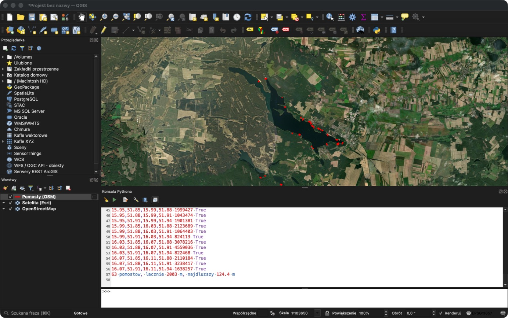
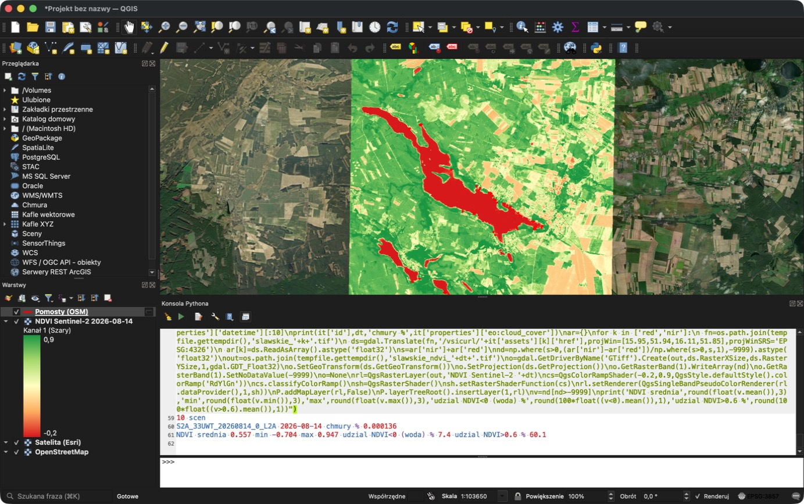
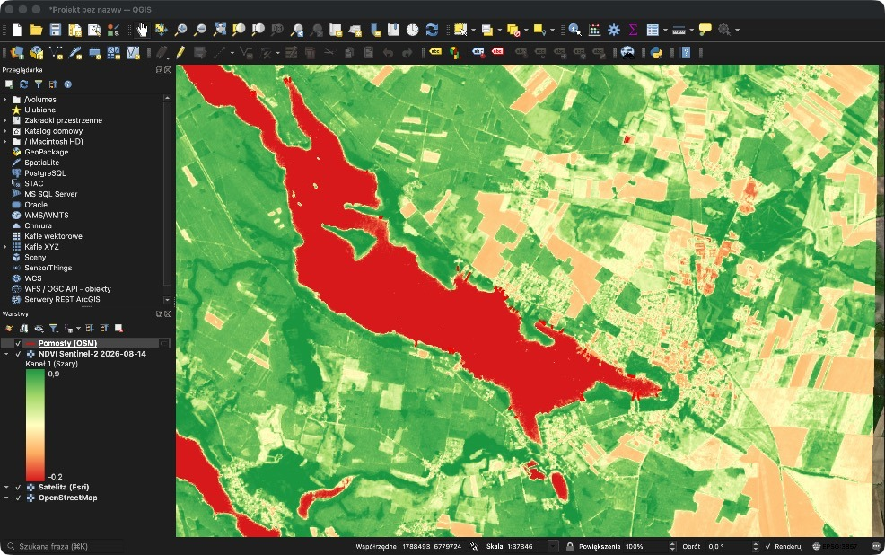

# Jezioro Sławskie w QGIS: pomosty i NDVI

Data wykonania: 10 października 2026
Narzędzie: QGIS 3 (macOS, polska wersja językowa)
Obszar: 15,95–16,11°E, 51,85–51,94°N (Jezioro Sławskie z otoczeniem, woj. lubuskie)

## Cel

1. Wczytać mapę Jeziora Sławskiego.
2. Znaleźć na niej pomosty.
3. Policzyć wskaźnik NDVI ze zdjęć satelitarnych.

## Dane źródłowe

| Dane | Źródło | Rozdzielczość |
|---|---|---|
| Mapa podkładowa | OpenStreetMap (kafle XYZ) | – |
| Zdjęcia satelitarne (podgląd) | Esri World Imagery (kafle XYZ) | wysoka, tylko RGB |
| Pomosty | OpenStreetMap, obiekty `man_made=pier` | wektor |
| Pasma do NDVI | Sentinel-2 L2A, kafel 33UWT, scena z 14.08.2026, zachmurzenie ok. 0% | 10 m |

## Krok 1. Podkłady mapowe

1. Otworzyć QGIS z nowym, pustym projektem.
2. W panelu **Przeglądarka** (po lewej) rozwinąć **Kafle XYZ** i kliknąć dwukrotnie **OpenStreetMap**. Warstwa pojawi się w panelu **Warstwy**.
3. Dodać zdjęcia satelitarne: prawy przycisk na **Kafle XYZ → Nowe połączenie**.
   - Nazwa: `Satelita (Esri)`
   - URL: `https://server.arcgisonline.com/ArcGIS/rest/services/World_Imagery/MapServer/tile/{z}/{y}/{x}`
   - Zatwierdzić przyciskiem **OK**.
4. Kliknąć dwukrotnie nową pozycję **Satelita (Esri)** w gałęzi **Kafle XYZ**.

Jeśli panelu Przeglądarka nie widać: **Widok → Panele → Przeglądarka**.

Układ współrzędnych projektu ustawi się sam na EPSG:3857 (widać go w prawym dolnym rogu okna), bo w tym układzie serwowane są kafle.

## Krok 2. Przybliżenie do jeziora

1. W pasku **Szukana fraza** (lewy dolny róg, skrót ⌘K) wpisać `> Jezioro Sławskie` i wybrać wynik z listy. Znak `>` uruchamia wyszukiwanie adresów w OpenStreetMap.
2. Dopasować kadr kółkiem myszy tak, żeby objąć całe jezioro ze Sławą, Lubiatowem i Radzyniem (skala ok. 1:100 000).
3. Zapisać kadr jako zakładkę: **Widok → Nowa zakładka przestrzenna** (⌘B), nazwa `Jezioro Sławskie`.

## Krok 3. Pomosty z OpenStreetMap

### Instalacja wtyczki

1. **Wtyczki → Zarządzanie wtyczkami…**
2. W wyszukiwarce wpisać `QuickOSM`, zaznaczyć wtyczkę i kliknąć **Zainstaluj wtyczkę**.

### Pobranie pomostów

1. **Wektor → QuickOSM → QuickOSM…**
2. W zakładce **Szybkie zapytanie** ustawić:
   - Klucz: `man_made`
   - Wartość: `pier`
   - Zakres: **Zasięg widoku mapy**
3. Kliknąć **Wykonaj zapytanie**. W panelu Warstwy pojawią się warstwy tymczasowe z pomostami (linie, ewentualnie także poligony i punkty).

### Kolor i długości

1. Dwuklik na warstwie liniowej → zakładka **Styl** → kolor czerwony, szerokość ok. 1,2 mm → **OK**.
2. Przeliczyć warstwę do układu metrycznego, żeby długości były w metrach: prawy przycisk na warstwie → **Eksportuj → Zapisz obiekty jako…**
   - Format: GeoPackage
   - Nazwa pliku: `pomosty.gpkg`
   - Układ współrzędnych: **EPSG:2180 (ETRF2000-PL / CS92)**
3. Otworzyć tabelę atrybutów nowej warstwy (prawy przycisk → **Otwórz tabelę atrybutów**), a w niej **Kalkulator pól**:
   - Nazwa nowego pola: `dlugosc_m`
   - Typ: liczba dziesiętna
   - Wyrażenie: `round($length, 1)`
4. Statystyki: **Wektor → Narzędzia analizy → Podstawowe statystyki dla pól**, pole `dlugosc_m`. W wyniku są m.in. liczba obiektów, suma i maksimum.

### Wynik

| Miara | Wartość |
|---|---|
| Liczba pomostów w kadrze | 63 |
| Łączna długość | 2003 m |
| Najdłuższy pomost | 124,4 m |

Liczby dotyczą całego kadru, czyli także kilku pomostów na mniejszych jeziorach na południe od Sławskiego.



## Krok 4. Pobranie zdjęć Sentinel-2

Zdjęcia Esri mają tylko kanały RGB, bez podczerwieni, dlatego do NDVI potrzebna jest scena Sentinel-2.

1. Wejść na Copernicus Browser (`https://browser.dataspace.copernicus.eu`) i zalogować się (konto jest darmowe).
2. Wyszukać na mapie Jezioro Sławskie.
3. W panelu wyszukiwania wybrać:
   - Źródło danych: **Sentinel-2**, poziom **L2A**
   - Zakres dat: 1.05.2026 – 30.09.2026
   - Maksymalne zachmurzenie: 10%
4. Z listy wyników wybrać scenę z **14.08.2026**, kafel **33UWT**, i pobrać ją.
5. Rozpakować archiwum. Potrzebne pliki leżą w folderze `GRANULE/…/IMG_DATA/R10m/`:
   - `…_B04_10m.jp2` – pasmo czerwone (RED)
   - `…_B08_10m.jp2` – bliska podczerwień (NIR)
6. W QGIS: **Warstwa → Dodaj warstwę → Dodaj warstwę rastrową…**, wskazać oba pliki i kliknąć **Dodaj**.

## Krok 5. Obliczenie NDVI

Wzór:

```
NDVI = (NIR − RED) / (NIR + RED)
```

1. Przybliżyć widok do zakładki `Jezioro Sławskie` (żeby liczyć tylko dla kadru, a nie dla całej sceny 110 × 110 km).
2. **Raster → Kalkulator rastra…**
3. W polu wyrażenia wpisać (nazwy warstw najwygodniej wstawiać dwuklikiem z listy po lewej):

   ```
   ("B08@1" - "B04@1") / ("B08@1" + "B04@1")
   ```

4. W sekcji zasięgu kliknąć przycisk używający **bieżącego zasięgu widoku mapy**.
5. Warstwa wynikowa: `ndvi_2026-08-14.tif`, format GeoTIFF.
6. Kliknąć **OK**. Nowa warstwa pojawi się w projekcie jako obraz w odcieniach szarości.

## Krok 6. Kolorowanie NDVI

1. Dwuklik na warstwie NDVI → zakładka **Styl**.
2. Typ renderowania: **Jednokanałowy pseudokolor**.
3. Min: `-0,2`, Max: `0,9`.
4. Paleta kolorów: **RdYlGn** (czerwony – żółty – zielony).
5. Interpolacja: **Liniowa**, potem **OK**.
6. W panelu Warstwy przeciągnąć warstwę NDVI pod warstwę pomostów, żeby czerwone linie były widoczne na wierzchu.

## Krok 7. Statystyki NDVI

1. **Processing → Panel algorytmów** (Ctrl+Alt+T).
2. Wyszukać **Statystyki warstwy rastrowej**, wskazać warstwę NDVI i kliknąć **Uruchom**. Wynik: średnia, minimum, maksimum.
3. Udział wody i gęstej zieleni: w **Kalkulatorze rastra** utworzyć warstwy pomocnicze `"ndvi@1" < 0` oraz `"ndvi@1" > 0.6` (wartość 1 tam, gdzie warunek jest spełniony), a potem dla każdej uruchomić **Statystyki warstwy rastrowej**. Średnia takiej warstwy to udział pikseli spełniających warunek.

### Wynik

| Miara | Wartość |
|---|---|
| Średnie NDVI w kadrze | 0,557 |
| Minimum | −0,704 |
| Maksimum | 0,947 |
| Udział pikseli z NDVI < 0 (woda) | 7,4% |
| Udział pikseli z NDVI > 0,6 (gęsta zieleń) | 60,1% |





## Interpretacja

- **Woda** ma ujemne NDVI, bo silnie pochłania podczerwień. Jezioro odcina się od lądu bardzo wyraźnie, więc próg NDVI < 0 nadaje się do wyznaczenia linii brzegowej.
- **Lasy** wokół jeziora mają NDVI powyżej 0,6 i zajmują większość kadru.
- **Pola i zabudowa** (okolice Sławy, pola na wschodzie) mają wartości pośrednie, od ok. 0,1 do 0,4; w połowie sierpnia część pól jest już po żniwach.

## Ograniczenia

- **Pomostów nie widać na NDVI.** Piksel Sentinel-2 ma 10 m, a pomost zwykle 1–3 m szerokości. Dlatego pomosty pochodzą z OpenStreetMap, a do ich obejrzenia służą zdjęcia Esri.
- **Kompletność OSM.** Warstwa zawiera tylko pomosty naniesione przez społeczność OSM; rzeczywista liczba może być większa.
- **Brak korekty przesunięcia odbicia.** Części scen Sentinel-2 L2A trzeba odjąć stałą 1000 od wartości pikseli przed liczeniem wskaźników. Tej korekty nie zastosowano, więc wartości NDVI mogą być lekko przesunięte; rozkład przestrzenny się nie zmienia.
- **Pomosty zamknięte w obrys.** Jeśli pomost jest w OSM narysowany jako obrys, podana długość to jego obwód, a nie długość osi.

## Zapisanie wyników

- Projekt: **Projekt → Zapisz jako…**
- Warstwy tymczasowe z QuickOSM (ikona „kostki” obok nazwy): prawy przycisk → **Eksportuj → Zapisz obiekty jako…** (GeoPackage), inaczej znikną po zamknięciu QGIS-a.
- Raster NDVI jest już zapisany jako GeoTIFF w miejscu wskazanym w kroku 5.
